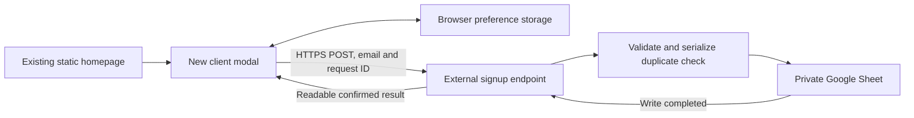
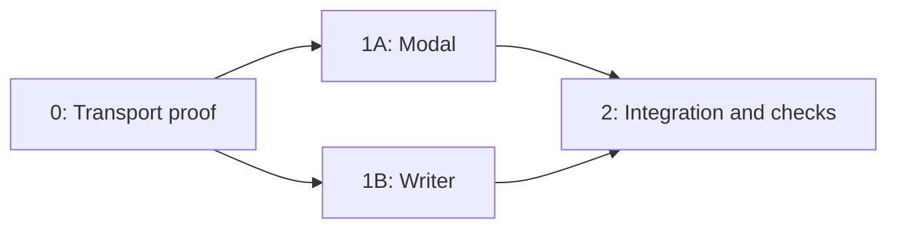

# Email signup modal — design and implementation outline

## Production rollout — 2026-11-02

User confirmed Brevo-hosted signup succeeds with CAPTCHA origin verification re-enabled, and previously confirmed email/list arrival. User requested production enablement and deployment help. Production preparation is complete: removed the development-only gate in app/page.tsx; the underlying landing page remains unchanged. Added a production-mode regression test, observed its intended failure before enabling the modal. All 100 tests across 12 files pass; ESLint, TypeScript and changed-file formatting pass. A clean isolated production export using the same GitHub Pages build environment succeeded. The exported signup HTML retains v3 CAPTCHA and production bundles include the modal. Build was isolated to preserve the local dev server.

- [x] Enable modal in production
- [x] Tests, lint, types, formatting and production static export
- [ ] Commit and push selected Brevo frontend changes to main
- [ ] Confirm GitHub Pages deployment succeeds
- [ ] User tests signup on www.franklinreed.com with origin verification enabled

Publishing workflow: .github/workflows/deploy-pages.yml builds and deploys automatically on pushes to main. Proposed commit: `feat(signup): launch Brevo email signup modal`. Publish only the selected Brevo frontend, preferences, related tests and plan; leave unused Google/Worker alternatives and local caches out of the release. No commit, push or deployment performed yet. Superbuild's explicit no-Git-operations instruction requires a user override before the agent performs publishing Git operations.

## ACTIVE: Brevo native HTML embed — 2026-11-02

User supplied the complete public Brevo HTML embed in attachment `2369a3c4-079f-4d07-87ed-173039566b68/Pasted text.txt`, authorizing integration into the validated modal. Brevo replaces the Google Sheets/Apps Script/Worker paths for this feature. Do not grant pending Google OAuth or deploy those alternatives. User chose double-confirmation email; success means confirmation requested, not a completed subscription.

Single local integration phase (5 points): preserve modal timing/dismissal/branding and unchanged underlying page; replace disabled/custom Apps Script form with native Brevo markup/scripts in a static same-origin iframe for CSS isolation (not a security boundary). Vendor scripts retain their supported form behavior and CAPTCHA. Keep exact action, public CAPTCHA site key, EMAIL/locale/honeypot fields. Add frame-only styling matching the validated input/button and exact success copy. Child sends size, Escape and Brevo success-panel activation to parent through postMessage; parent checks origin and event.source before accepting. Store suppression only on acknowledged confirmation request or dismissal, with no email in localStorage. Native Brevo owns request/error/success; no hand-written opaque AJAX success. Include fallback hosted Brevo link. Form is development-preview-only until user validates live email/DOI and requests publication. No test emails or CAPTCHA completion by agent.

TDD tasks: (1) replace modal unit tests to verify iframe source/title, source+origin checks, bounded size, Escape and confirmation-request suppression; run RED then implement; (2) verify static HTML retains official scripts/CAPTCHA/honeypot/action and labels/success wording; run RED before authoring static HTML; (3) run full unit suite, lint, typecheck, changed-file formatting. Avoid production build alongside dev server due prior cache collision. Keep Google/Worker files unused for now rather than deleting unrelated work.

- [x] Native Brevo embed and isolated styling
- [x] Modal integration and message validation tests
- [x] Local checks and served form verified
- [x] User completes hosted CAPTCHA, confirmation email and Brevo list verification

Definition of Done for local code: failing tests observed, new/existing tests pass, lint/types/format pass, local HTTP response verified. Live acceptance remains pending; do not claim end-to-end capture from mocked events. Proposed commit: `feat(signup): connect launch modal to Brevo signup form`.

Local results: 98 tests pass in 12 files, full ESLint and TypeScript pass, changed-file formatting passes. Six intended failures were observed before implementing the native embed. Retained action and reCAPTCHA site key from supplied HTML; all Brevo CSS/scripts are inside `public/signup/brevo.html`, with frame-only brand styling. Main page imports no vendor CSS and uses no Google/Worker signup client. Parent validates message origin/source before accepting bounded height, Escape or confirmation-requested messages. Local development server restarted. No CAPTCHA solved, no email submitted, no live DOI/list acceptance claimed. Production still excludes the modal; publication awaits user review. Browser automation cannot inspect localhost under the earlier URL-policy rejection; do not use alternate surfaces to bypass it. User should validate local CAPTCHA/domain behavior and actual confirmation delivery.

## Active demo phase — personal account, isolated synthetic data

Follow-up review: added a failing storage-getter regression test and fixed confirmed-success handling so blocked browser preferences cannot turn a confirmed save into a displayed failure. Updated verification: 97 tests pass across 11 files; lint, typecheck and changed-file formatting pass. Live Google authorization remains the only current account-side blocker before endpoint/readback tests; no completion claim for the full demo.

Progress 2026-10-29: D1 and D2 local code implemented and independently verified: 96 tests pass across 11 files; lint, typecheck and changed-file formatting pass. Proposed commits: `feat(signup): add confirmed Apps Script browser transport`; `feat(signup): connect demo modal to verified signup service`. No git mutations. Apps Script code uploaded and Script Properties saved for test-only example.com addresses, isolated Sheet, dummy key/secret, localhost and hourly cap5. Deployment reached Google authorization but has not completed. Google displays “Google hasn’t verified this app” for the personal-account project; user must review the warning and sensitive permissions before granting access. Auth popup and deployment tab are preserved for handoff. No Google authorization granted, no endpoint configured locally, no real Sheet writes verified. No live success claims. Resume after user authorizes/reviews permissions; collect deployed exec URL, configure ignored .env.local with endpoint and public dummy site key, restart dev server, verify one row and duplicate/failure behavior, and keep website production disabled until Julie handoff.

User explicitly approved proceeding with the personal Gmail-owned demo Sheet before Julie's launch setup. This supersedes the earlier prohibition on enabling a personal-account test deployment. Deploy only against `148_d0OY1QxfElNyNl8DZUwtiSBqEQ54utYmExWcQed0` with ENVIRONMENT=test, example.com addresses, official Cloudflare dummy test key/secret, hostname localhost, action test, hourly cap 5. Default production mode rejects dummy secrets. This demo proves plumbing, not real bot detection. No real signups or public website deployment.

Parallel local tasks: D1 Apps Script browser client (3 points; `lib/signup-client.ts`, tests), D2 conditional modal/Turnstile wiring (5 points; component/CSS/tests, optional Turnstile component), while root configures the isolated test service. Each task tests first then implements and runs focused checks; root independently runs complete gates. Endpoint/site key absent keeps preview disabled. Production page still does not mount a modal. Demo enables in development only once local env is supplied. Persistent app authorization/public endpoint exposure require action-time Google permission review. Do not claim saved rows without connector readback.

## Current decision — Apps Script in dedicated brand account (2026-10-29)

User changed direction back to Apps Script with bot blocking, owned by a dedicated Franklin Reed Google account. This supersedes the Cloudflare Worker/service-account replacement below. Keep Worker implementation unmounted and undeployed as an alternative; no service account or key was created. The dedicated Google Cloud project was created but has no service account; do not continue its setup. Apps Script also remains undeployed. Existing Sheet/script are currently in the personal account; brand account address and sign-in are pending. Create or transfer the destination and service under the brand account only after that identity is confirmed; do not enable the personal-account prototype.

Use Turnstile server-side verification (success, allowed hostname, action signup) in Apps Script, requiring token on every attempt. Keep secret in Script Properties. Honeypot, strict input validation, and duplicate lock remain. Replace best-effort CacheService cap with durable hourly accepted-signup counter in Script Properties, under the same script lock. Apps Script cannot enforce trusted per-IP edge limits and invalid submissions can still consume execution/verification quotas. Do not claim equivalent denial-of-service protection to the Worker design. No fake successes or no-cors acknowledgements.

Current next phase: prepare/test Apps Script bot verification, then configure the brand account and Turnstile widget, test live browser confirmation against isolated test Sheet, and only then connect frontend. Production and local preview remain unchanged pending those gates.

Preparation results: added challenge/hostname/action/failure/hourly-cap tests before implementation; six intended failures were observed, then all 15 Apps Script tests passed. Full suite is 83 tests across 11 files (includes the undeployed Worker alternative and its browser client). Full lint and typecheck passed; changed code/docs formatting passed. Apps Script source and README now require the brand account, Turnstile secret and exact allowed hostnames. These changes are local only and have not been pasted into or deployed from the personal-account prototype. Brand account address/sign-in and Turnstile configuration remain pending; no live Google writes or browser bot challenge claims. Proposed selected-path commit: `feat(signup): protect Apps Script capture with Turnstile`.

Alternative-path suggested commits from completed parallel preparation: `feat(signup): add protected Cloudflare signup service`; `feat(signup): add verified secure browser submission client`. These are unselected and undeployed. Worker local bundle dry-run passed, but no service account, key, sheet access grant or Worker was created. Only the empty Google Cloud project Franklin Reed Signup (`robotic-tiger-513116-e7`) was created before the user's direction change; leave it unused. Do not continue provisioning it.

## Approved security architecture replacement — 2026-10-29

User selected Cloudflare Worker + Turnstile + a Google service account restricted through file sharing to the signup Sheet. This supersedes all Apps Script deployment recommendations below. The Apps Script project stays undeployed and its source is archival only.

Execution phases now: S1A Worker security and Google transport (8 points), parallel with S1B browser submission client (3 points); S2 account configuration and verified live test (5 points, depends on S1A/S1B); S3 frontend Turnstile UI integration and deployment review (5 points, depends on S2). Keep local preview disabled until real verification. Parallel agents own independent backend/client files. Do not change the validated modal in this phase.

S1A exact deliverables: `integrations/cloudflare-signup/worker.ts`, `integrations/cloudflare-signup/google.ts`, and `tests/unit/cloudflare-signup.test.ts`. Write failing tests, confirm failures, implement minimum to pass. Public POST-only `/signup`, exact origin allowlist (not authentication), 4KB streaming body limit, strict email/UUID/consent/honeypot validation, per-IP request limiter before external calls, required server-side Turnstile success/hostname/action checks, timeouts, no credential or PII logging, no read endpoint. Google service account has no project role or domain delegation; only share the signup Sheet with it. Web Crypto signs short-lived OAuth JWT; server-held private key only. Durable Object storage transaction reserves email hash/request ID and a global hourly cap before append; pending/ambiguous writes must never yield success or blind re-append. No unbounded Google operations. Unit tests cover abuse rejection, durable deduplication, ambiguous writes and Google auth failures.

S1B exact deliverables: `lib/signup-client.ts`, `tests/unit/signup-client.test.ts`. Failing tests then strict HTTPS endpoint, JSON POST, timeout, request-ID acknowledgement verification, no opaque/no-cors success, safe error mapping; require a Turnstile token and preserve request ID for retry. Keep UI unchanged until S3.

S1 gates: full unit suite, lint, typecheck, changed-file formatting, Worker dry-run when tooling is available. Browser runtime, real Google writes, live Turnstile and ≥80% measured coverage remain separate acceptance gates; no inference of live security from mocks. S2 requires account access and action-time confirmation before creating persistent credentials, granting service-account access, or exposing a public endpoint. Never store secrets in repository or browser bundle; ignore local credential/environment files before setup.

- [ ] S1A backend tests first and security service implemented
- [ ] S1B browser client tests first and implemented
- [ ] S1 checks independently verified
- [ ] S2 Cloudflare and restricted Google account configuration
- [ ] S2 real bot verification/save/deduplication/failure tests
- [ ] S3 live frontend integration, review and rollout

## Approved execution adjustment — local preview first

User approved building the local preview before live transport validation on 2026-10-29. This replaces the connection-first dependency for the preview only. Production collection remains disabled. Execute one preview phase now (5 points); then return to Phase 0 transport validation, 1B collection, and Phase 2 rollout. Original Phase 1A is partially delivered by this preview; connected submission states still depend on the real service.

### Preview phase — 5 points — Complete (local checks)

Files: CREATE `components/signup/signup-modal.tsx`, `components/signup/signup-modal.module.css`, `lib/signup-preferences.ts`, `tests/unit/signup-modal.test.tsx`, `tests/unit/signup-preferences.test.ts`; MODIFY `app/page.tsx` to append the development-only modal as a sibling of existing main. No global CSS or existing content edits.

Task P1: preference behavior. Write failing tests for missing storage, dismissal before/at 30 days, malformed and unavailable storage, invalid/future timestamps, and subscribed suppression. Run the focused Vitest file and verify missing implementation failure; implement versioned local-storage helpers; rerun and verify all cases pass.

Task P2: dialog preview. Write failing tests for two-second timing, disabled submission with explicit preview text, close/Escape/backdrop dismissal, hidden tab handling, and remembered dismissal. Confirm focused tests fail before implementation. Implement a body portal with native dialog and scoped mockup styling. No fetch or fake successful signup. Run tests and verify passing.

Task P3: integration. Keep existing homepage main, header, hero unchanged. Render preview only in development; production static export contains no active collection modal. Run full unit suite, lint, formatting, and type checking. Run static build. Use the existing development server for review. Browser access was policy-blocked; do not bypass that block or claim visual browser verification.

Quality gate scope: unit behavior, lint, types, formatting and production build. Coverage percentage and browser visual/accessibility acceptance remain pending in the original integration phase; do not claim the original Phase 1A complete from jsdom tests alone.

- [x] Preference tests first, red then green
- [x] Modal tests first, red then green
- [x] Development-only homepage mount
- [x] Unit tests, lint, format, typecheck, static export pass
- [x] Plan progress updated and proposed commit message output
- [ ] **CHECKPOINT: Run `/compact focus on: local preview complete, production collection disabled, Google transport validation remains next`**

Generated: 2026-10-29. Status: design review; transport validation pending.

## Goal and scope

Add an email-only signup overlay to the existing Franklin Reed homepage. Save confirmed submissions to the private Google Sheet, then show a thank-you message. Preserve the current page beneath it. This document records repository findings and a phased design; it is not yet the fully expanded, code-complete superplan execution packet. Expand transport-specific code and failing tests after Phase 0 establishes a working browser contract.

Source: user request and supplied blue bathroom mockup. The mockup is visual reference, not an instruction to replace the existing page or background.

Confirmed: email only; timestamp; thank-you state; CRM and automated emails deferred; two-second popup delay; 30-day dismissal suppression; successful signup suppressed on the same browser; mobile and keyboard support. User authorized creation of the Google Sheet. No webpage implementation or deployment is authorized by this planning document alone.

## Existing repository

| Area | Evidence | Consequence |
| --- | --- | --- |
| Homepage | `app/page.tsx:1–13` renders header and hero | Mount one isolated client component without changing existing elements |
| Hero | `components/home/hero-section.tsx` | Preserve Face It / Confidence / Starts Here wording and layout |
| Branding | `app/globals.css` | Reuse navy/blue tokens and serif/sans fonts in scoped CSS |
| Hosting | `next.config.ts`, `.github/workflows/deploy-pages.yml` | Static export to GitHub Pages; no runtime Next API route |
| Content | `content/site.ts` | Keep existing copy untouched; put signup copy in its own file |
| Other route | `app/about/page.tsx` | Exists in repo; modal remains homepage-only |
| Tests | `tests/unit/home-page.test.tsx`, `tests/setup.ts` | Existing static assertions protect the underlying page |

Stack: TypeScript 6, Next 16, React 19, pnpm 10.31.0. ESLint, Prettier, type checking, Vitest/jsdom/Testing Library exist. Playwright is installed but has no configuration/specs. Coverage provider/thresholds are absent. Deployment currently builds without running other quality checks. No applicable AGENTS.md/CLAUDE.md was found; research was not bypassed.

Refactor assessment: LOW need. Components are small and focused. No preliminary refactor or dependency upgrades are warranted. Add only tooling required for the new acceptance checks.

## Design recommendation

Use the mockup's dark navy panel, thin blue border, blue serif headline, white supporting copy, email input, blue button, and prominent close control. Keep the actual existing website visible behind a dimmed backdrop; do not introduce the bathroom photograph.

Proposed copy:

- Brand: FRANKLIN REED
- Heading: Confidence is coming.
- Supporting line: Look Good. Feel Good. Do Good Things.
- Button: Count Us In
- Expectation text: Sign up for Franklin Reed launch news and updates.
- Success: You're on the list. We'll be in touch when Franklin Reed launches.

The expectation text is a proposed addition to clarify what the signup means. Its version is stored alongside the email. It does not establish verified email ownership or double opt-in. No privacy-policy link should point to a nonexistent page.

Desktop: centered panel capped around 44rem, generous padding, typography scaled to the current page. Mobile: fluid panel, at least 16px input type, safe-area margins, 44px close target. Use a maximum height based on the dynamic viewport and allow internal overflow for small screens, zoom, or the keyboard. Do not promise a zero-scroll modal at every screen size.

Behavior:

- Start a two-second timer after client mount while the document is visible; pause/restart when returning from a hidden tab. Delay is a design choice, not an experimentally proven conversion optimum.
- Render no dialog on the initial server/client pass. Missing endpoint configuration keeps the modal disabled.
- Dismiss with close button, Escape, or an intentional backdrop click. Remember dismissal for 30 days. Do not dismiss on input or inside-panel clicks.
- Store only a versioned dismissal timestamp and subscribed flag locally, never the email. Storage denial must not crash the page; suppression is best effort per browser, not per person.
- After confirmed success, persist subscribed state and replace the form with a thank-you state. Let the visitor close it; no forced redirect or immediate auto-close.
- Retain input on failure, announce the error, and offer manual retry. Block repeat clicks during a pending request. Retry with the same request ID after an ambiguous timeout.
- Use native `<dialog>.showModal()` where supported, with accessible heading, focus containment, inert background, Escape handling, and focus restoration. For automatic opening, restore prior focus or focus the existing main landmark programmatically without changing its appearance. Do not auto-focus the email input on mobile and trigger the keyboard unexpectedly; initially focus the heading or close button.

There is intentionally no permanent reopen button in this version because it would change the underlying page. A visitor who dismisses cannot reopen until suppression expires or browser storage is cleared. Record this tradeoff for review.

## Integration options

| Approach | Benefits | Costs / limitations | Recommendation |
| --- | --- | --- | --- |
| Google Apps Script web app → Sheet | Small Google-owned setup; no website hosting move | Public deployment permissions and readable cross-origin POST response must be verified; quotas and limited abuse controls | Try first in an isolated spike |
| External serverless endpoint → Sheets API | Explicit HTTP/CORS behavior, secret storage, stronger rate controls | Adds another service/account and credential setup | Fallback if Apps Script cannot meet the contract |
| Google Form → linked Sheet | Google-managed capture | Less control over branded inline interaction and verified confirmation | Fallback only if simpler capture outweighs exact modal UX |

Do not use `fetch` with `mode: "no-cors"` and then show success. An opaque response does not prove the email was saved. Do not add a proxy service merely to hide a transport failure without reviewing its ownership and credentials.

## Architecture

Component tree: HomePage → existing main(Header, Hero), plus SignupModal → Dialog → EmailForm or SuccessMessage. No global stylesheet edits. Keep server-rendered page/content and SEO intact.

### Data destination

Created: https://docs.google.com/spreadsheets/d/1DWa2D3SlXMoHKOqWXiDqW_ntMeemqnq6yokhSndb7KM/edit

Tab: `Signups`; sheet ID `372176587`; frozen header row; no fabricated subscribers. Stored in the connected account's ChatGPT folder. No public sharing was added.

| Column | Type / ownership |
| --- | --- |
| Email address | Validated, trimmed email; duplicate comparison case-insensitive; preserve original normalized display value |
| Signed up at (UTC) | Server-generated timestamp; explicitly UTC, independent of the spreadsheet's default timezone |
| Source | Fixed server-owned `homepage-modal` |
| Consent copy version | Server-accepted version, initially `launch-v1` |
| Request ID | Validated UUID, used for safe retries |

No database migration is required. Never change column order without updating the writer. Write untrusted strings as literal text, not executable spreadsheet formulas. No IP address, user agent, or full referring URL is collected.

### Proposed application contract

Endpoint URL is deployment output, not invented in advance. Send email only in POST body, never query strings. Browser receives no Google credentials. Endpoint is public to visitors; URL secrecy is not authentication.

Request fields: `email` (required, trimmed, valid, maximum 254 characters); `requestId` (required UUID); `consentVersion` (`launch-v1`); `website` (empty honeypot). Source and timestamp are server-owned. Enforce a small request size limit before parsing. Never log full addresses or payloads.

Success body: `{ "ok": true, "requestId": "<matching UUID>" }`. Return identical success for a duplicate email without revealing list membership. Confirm success only after the durable append or a locked lookup confirms an already-saved row. Use a script lock around lookup plus append in Apps Script. Release locks on every exit.

Application error codes: `INVALID_EMAIL`, `INVALID_REQUEST`, `BUSY`, `UNAVAILABLE`. The client must handle non-2xx responses, malformed JSON, HTML login/error responses, mismatched request IDs, opaque responses, and timeouts as unconfirmed failures. Timeout target: 15 seconds; no automatic repeated submissions.

If a serverless HTTP endpoint is selected: 201 new save, 200 duplicate/retry, 400 validation, 403 forbidden origin where applicable, 405 method, 413 oversized body, 429 rate limit with Retry-After, 503 write/quota/lock failure, and preflight 204. Apps Script may express application failures within a readable 200 JSON envelope; do not assume it can set the same HTTP statuses. Phase 0 must document observed platform responses and finalize the client parser accordingly.

Allow configured production origins where supported, but do not treat CORS as bot protection. Add honeypot, bounded inputs, serialized deduplication, and conservative server-side throttling within the chosen platform's actual capabilities. Apps Script quotas are a capacity limit, not robust abuse protection. Escalate to a rate-controlled endpoint if traffic/abuse demands it. No list-read endpoint.

## Phases and estimates

| Phase | Name | Depends on | Parallel with | Points | Status |
| --- | --- | --- | --- | --- | --- |
| 0 | Verify browser-to-Sheet transport and expand execution packet | None | None | 3 | Pending |
| 1A | Build isolated modal and preferences | 0 | 1B | 5 | Pending |
| 1B | Implement validated writer and client contract | 0 | 1A | 5 | Pending |
| 2 | Connect, verify, and prepare rollout | 1A, 1B | None | 3 | Pending |

Total: 16 relative points; not a calendar estimate. Parallel phases use separate agents, with distinct file ownership.

### Phase 0 — transport proof (3)

Use an isolated test sheet/deployment to verify public anonymous POST from localhost and the intended production origin in desktop Chrome/Safari and mobile Safari/Chrome. A valid submission must produce both a readable matching response and exactly one saved row. A repeated request and repeated normalized email must not create another row. Test invalid input, denied write permission, quota/lock failure, and timeout. Remove synthetic test records before delivering the production destination.

Confirm the connected account can own/deploy Apps Script with anonymous access under its account policy. Google account authorization may require the owner to complete the deployment consent. No endpoint is currently created or deployed.

If direct Apps Script POST cannot reliably provide the required readable response, select a serverless host and document its setup before implementation. Finalize deployment ownership, HTTP status behavior, abuse controls, and exact secrets/configuration. Expand this outline into full per-task runnable test code and exact code deltas, using superplan's five-step TDD structure. Do not mark this outline execution-ready before that expansion.

Definition of Done: transport evidence recorded; service selected; full code/test packet expanded; lint, format, typecheck, all new/existing tests pass for any repository changes; ≥80% coverage of new testable logic; no new warnings. Test plan expectations are not reported as executed results.

- [ ] **CHECKPOINT: Run `/compact focus on: Phase 0 complete, selected transport and deployment ownership recorded, exact request/response contract validated, Phase 1A and 1B file ownership`**

### Phase 1A — modal (5)

Planned creates: `components/signup/signup-modal.tsx`, `components/signup/signup-modal.module.css`, `content/signup.ts`, `lib/signup-preferences.ts`, `tests/unit/signup-modal.test.tsx`, `tests/unit/signup-preferences.test.ts`.

First test timing at 1999ms/2000ms, visibility behavior, all dismissal paths, 30-day boundary, malformed/blocked storage, subscribed suppression, pending form, failure and success states. Then implement one behavior at a time, confirm each fails before implementation and passes afterward. Native dialog mechanics require real-browser checks rather than relying on jsdom mocks alone.

Keep component unmounted from the production page until Phase 2. Use a typed injected submit function for isolated UI testing. Use a CSS module and existing tokens; keep all input, button, and dialog resets scoped. Retain the actual page's existing stylesheet, header, hero, footer, and artwork unchanged.

Definition of Done: code passes lint, format, typecheck; all new/existing tests pass; ≥80% coverage of new testable code; no new warnings; UI supports mobile keyboard, 200% zoom, reduced motion, visible focus, and screen-reader labels.

- [ ] **CHECKPOINT: Run `/compact focus on: Phase 1A complete, modal and preferences files, suppression and accessibility behavior, Phase 2 mounts without altering existing page`**

Suggested completion message: `feat(signup): add accessible launch signup modal`. Output actual changed files when complete; do not commit automatically.

### Phase 1B — collection service (5)

Planned creates: `lib/signup-client.ts`, `tests/unit/signup-client.test.ts`, `integrations/google-signup/README.md`; add platform-specific implementation and tests after Phase 0 selects the transport. Do not choose pretend file contents or secret names before that decision.

First test validation, normalized duplicates, UUID retry, formula-like input, concurrent requests, write failure, unsupported methods, and response parsing. Then implement validation, serialization, literal writes, throttling, and the thin browser adapter. Configure spreadsheet ID on the service, never a browser credential. Keep errors generic and avoid reflecting addresses in responses/logs.

Definition of Done: code passes relevant lint, format, typecheck; all new/existing tests pass; ≥80% coverage of new testable code; no new warnings; verified write acknowledgement and concurrency behavior; private sheet access preserved.

- [ ] **CHECKPOINT: Run `/compact focus on: Phase 1B complete, endpoint URL and contract, service configuration location, duplicate and failure semantics, Phase 2 integration`**

Suggested completion message: `feat(signup): persist confirmed signups to Google Sheets`. Output actual changed files when complete; do not commit automatically.

### Phase 2 — integration and rollout preparation (3)

Modify `app/page.tsx:1–13`: import SignupModal, wrap existing main and modal in a fragment, and append the modal as a sibling. No existing main/header/hero nodes or class names change. Component portals its dialog to the body to avoid becoming another site-shell grid item.

Modify `.github/workflows/deploy-pages.yml`: supply `NEXT_PUBLIC_SIGNUP_ENDPOINT` from a repository variable at build time. This URL is public. Preserve GitHub Pages and static export. Add relevant lint, formatting, typecheck, and unit gates before building. Add Playwright configuration and `tests/e2e/signup.spec.ts`; exclude E2E files from Vitest discovery. Add coverage provider/configuration compatible with the installed Vitest version if retaining the ≥80% gate.

Write browser tests first for baseline page before opening; visible modal; keyboard/close behavior; mobile fit; failure/retry; duplicate request; and verified success. Compare the existing page's screenshot and element bounds before opening and after closing. Ensure the dialog adds no layout shift. Use mocks for routine CI and a controlled isolated sheet for actual write verification, not production subscriber data.

Rollout: missing/empty endpoint disables the feature. Review preview, verify real destination write, then publish only after user requests deployment. Rollback: remove the endpoint variable and rebuild, leaving already-collected rows intact. Never delete signup data as part of rollback.

Definition of Done: lint, format, typecheck, new/existing unit and browser tests pass; ≥80% new-code coverage; static export succeeds; no new warnings; mobile and desktop visual review passes; real write and confirmed success verified; existing page unchanged when closed.

- [ ] **CHECKPOINT: Run `/compact focus on: Phase 2 complete, verified preview and Google Sheet writes, rollback configuration, user review before deployment`**

Suggested completion message: `feat(signup): connect homepage modal to verified email capture`. Output actual changed files when complete; do not commit automatically.

## Validation commands and expected outcomes

These are future gates, not results obtained during planning.

| Command | Expected outcome |
| --- | --- |
| `pnpm lint` | Exit 0, no ESLint warnings/errors |
| `pnpm format:check` | Exit 0, formatting accepted |
| `pnpm typecheck` | Exit 0, no type errors |
| `pnpm test -- tests/unit/signup-preferences.test.ts` | Red before behavior exists, then all preference cases pass |
| `pnpm test -- tests/unit/signup-modal.test.tsx` | Red before behavior exists, then modal interaction cases pass |
| `pnpm test -- tests/unit/signup-client.test.ts` | Red before transport logic exists, then confirmation/failure cases pass |
| `pnpm test` | All new and existing unit tests pass |
| `pnpm exec vitest run --coverage` | After provider/configuration setup, ≥80% new-code coverage |
| `pnpm test:e2e` | After configuration, critical browser journeys pass |
| `pnpm build:pages` | Exit 0 and static `out` generated |

## Open decisions and limits

Transport deployment/account permissions and actual browser response behavior remain unverified. Apps Script is a recommendation, not a completed integration. Mockup wording is the working design reference; expectation/success text is proposed. No special volume or security requirements were supplied; protections above are the proposed baseline. No conversion-rate target was invented. No analytics platform or cookies beyond local preference storage are added.

The created sheet is empty and is not yet receiving submissions. Local workbook preview was checked and native header values, styling, and frozen row were verified through the Sheets API; a Google-rendered visual preview was not inspected.

## Primary references

- [Google Apps Script web apps](https://developers.google.com/apps-script/guides/web): ownership, execution identity, deployment access.
- [Apps Script Content Service](https://developers.google.com/apps-script/guides/content): GET/POST and response redirects; requires browser validation for this use.
- [Apps Script LockService](https://developers.google.com/apps-script/reference/lock/lock-service): serialize duplicate check plus append.
- [W3C modal dialog pattern](https://www.w3.org/WAI/ARIA/apg/patterns/dialog-modal/): focus, keyboard operation, accessible labeling.
- [Google interstitial guidance](https://developers.google.com/search/docs/appearance/avoid-intrusive-interstitials): avoid obscuring access to main content; two seconds does not remove this concern.

Next action: review this design; then validate the collection transport and expand the code-complete execution packet before building the modal.

## Preview verification — 2026-10-29

## Collection service preparation — 2026-10-29

Phase 0 remains in progress: no live transport proof or deployment yet. Prepared `integrations/google-signup/Code.gs` and setup README. Added nine writer tests first and observed missing-file failures, then passed all nine; full suite now has 31 passing tests across nine files. Lint and typecheck pass. Browser preparation uses Apps Script project `1MicMFRRmcyuw_iPmXv3RxNpVQylfUUGQ8FiEqZYLz8kgySjxEOOVa332`, titled Franklin Reed — Email Signup Service. Code was saved through the editor. Script property SPREADSHEET_ID points to isolated test sheet `148_d0OY1QxfElNyNl8DZUwtiSBqEQ54utYmExWcQed0`, tab Signups, copied from the blank production sheet. No production rows written.

Prepared deployment dialog: Web app, execute as owner aridfranklin@gmail.com, visitor access Anyone, description Isolated signup integration test. Deploy has NOT been clicked. Browser safety requires action-time confirmation for this new public endpoint and subsequent authorization scope expansion. Awaiting that confirmation. After deployment, verify actual OAuth scopes, real write/deduplication and readable browser response before enabling frontend. Website remains the disabled development-only preview. Do not claim the collection phase or Google integration complete.

User acceptance: fully validated by the user on 2026-10-29 after reviewing the local preview. Dismissal persistence was explicitly confirmed earlier; the user subsequently confirmed all requested preview checks complete (Escape, keyboard containment, and narrow-screen layout). Local visual/interaction acceptance is complete. This does not validate live email submission, which remains disabled pending the Google Sheets integration phase.

Local preview phase complete: 8 test files / 22 tests pass, including 15 new signup cases. ESLint, TypeScript, changed-file formatting and production static build pass. Local server returns HTTP 200. Existing Next workspace-root warning remains; no new warning was introduced. Browser visual verification remains unavailable after browser security-policy rejection; do not bypass it. Preview tab opening was requested through Codex. Production page mounts no modal. Google endpoint and live collection remain unimplemented. Proposed commit: `feat(signup): add development-only email signup preview`. No git mutations performed.

### CAPTCHA embed correction — 2026-11-02

Applied the updated Brevo reCAPTCHA v3 markup and script URL, removing the old checkbox callback and styling. Regression tests first reproduced the mismatch, then passed after replacement. All 99 tests across 12 files pass; lint, TypeScript and changed-file formatting checks pass. Local form HTML returns HTTP 200 and includes the v3 integration. User verification of CAPTCHA, double opt-in email and Brevo list arrival remains pending; production remains disabled.
